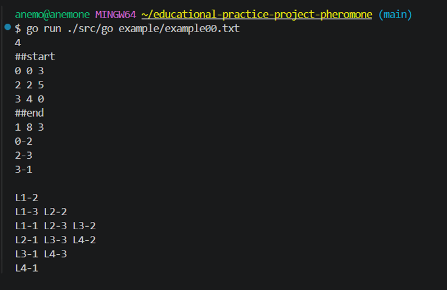
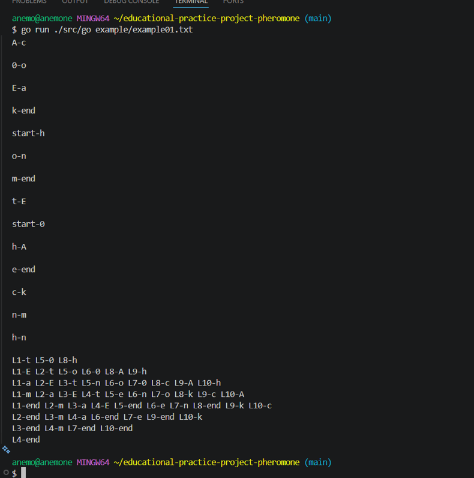

# Ant Farm Simulation

A team project that finds paths through a network of rooms and tunnels and simulates ants moving from start to finish.

Built with Go, Python and Three.js.

## Run

Requires Go and Python.

```bash
go run ./src/go example/example00.txt
```

Generate a JSON file for visualization:

```bash
go run ./src/go --json colony.json example/example05.txt
```

Open `src/visualizer3d.html` in a browser and load `colony.json`.

For terminal visualization:

```bash
python -m pip install -r requirements.txt
python src/visualizer3d.py colony.json
```

## Screenshots





## Team

- [Aruzhan Abdrakhmanova](https://github.com/arabdrakh)
- [Abbaskhan Ibraimov](https://github.com/Abbaskhan07)
- [Nikita Zuy](https://github.com/V01demort)

A copy of our Pheromone team project, published with the team's permission. AI tools were used during development. The copied commit history does not reliably show individual contributions.
