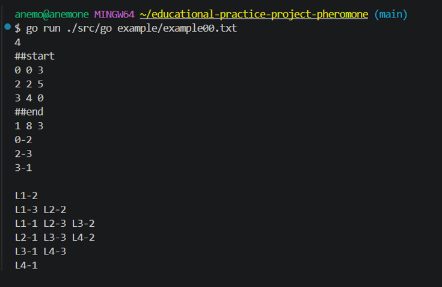
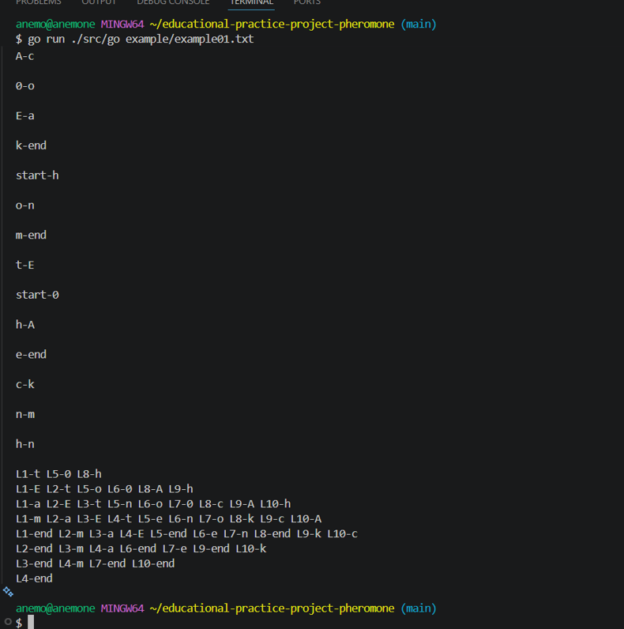

# Ant Farm Simulation — Educational Practice

A team university project completed during Educational Practice at **Astana IT University** (2026, group IT-2501).

This is a **team project**, published here as a portfolio copy with the team's permission. It is not presented as an individual project. The original university repository is private.

## What it does

The program reads an ant farm defined by rooms and tunnels, searches for routes between a start and an end room, and simulates ants moving through the network. The project also includes terminal and browser-based visualizations.

## Technologies

- **Go** — graph parsing, route selection, simulation
- **Python** — terminal visualization
- **HTML/CSS and Three.js** — browser-based 3D visualization

## Team

- **Aruzhan Abdrakhmanova** ([arabdrakh](https://github.com/arabdrakh))
- **Abbaskhan Ibraimov** ([Abbaskhan07](https://github.com/Abbaskhan07))
- **Nikita Zuy** ([V01demort](https://github.com/V01demort))

The work was developed collaboratively, including the use of AI-assisted tools. Historical commit authorship and the earlier division of tasks should **not** be treated as verification of individual contributions.

## Quick start

Requirements: Go and Python. Install Python requirements when needed:

```bash
python -m pip install -r requirements.txt
```

Run a sample simulation:

```bash
go run ./src/go example/example00.txt
```

To export a JSON trace for the browser visualizer:

```bash
go run ./src/go --json colony.json example/example05.txt
```

Then open `src/visualizer3d.html` in a browser and load `colony.json`.

For terminal visualization:

```bash
python src/visualizer3d.py colony.json
```

## Screenshots




## Attribution

Portfolio copy of the collaborative **Pheromone** educational-practice project (AITU, 2026). The source is shared with team permission; no personal authorship claims are made about specific files.
